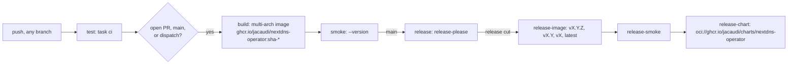

# CI/CD Workflows

One orchestrator, [`ci.yaml`](workflows/ci.yaml), calls local reusable stages in this repo. Nothing is called across a repo boundary at runtime. The only required status check is **`ci`**.



| Stage | File | What it does |
|---|---|---|
| test | `ci-test.yml` | Runs `task ci`: actionlint, yamllint, hadolint, helm lint, golangci-lint, govulncheck, `go test -race`, the 70% coverage floor, and the generated-artifact drift gate |
| build | `ci-build.yml` | Multi-arch (amd64, arm64) image pushed to GHCR and pinned by digest; stamps `VERSION`/`COMMIT`/`DATE` build args |
| smoke | `ci-smoke.yml` | `task smoke`: boots the image and checks `--version` |
| release | `ci-release.yml` | release-please: opens or updates the release PR, and tags when it merges |
| release-chart | `ci-chart.yml` | Publishes the chart in lockstep with the app (chart version = tag) after checking that `appVersion` matches and the image exists |
| — | `release-republish.yml` | Manual repair: retag or rebuild a release image |

## Test images from a branch

Open a PR (a draft PR is enough). Every push to its branch then builds and smoke-tests `ghcr.io/jacaudi/nextdns-operator:sha-<short>`. Branches without an open PR run `test` only. For a one-off build, run **CI** manually with `workflow_dispatch` on the branch.

## Releases

[release-please](https://github.com/googleapis/release-please) reads Conventional Commits on `main` and keeps a release PR open. Merging that PR tags `vX.Y.Z`, then publishes the image and the chart. The version lives in `.release-please-manifest.json`, and `chart/Chart.yaml` `version`/`appVersion` follow it through `# x-release-please-version` annotations.

| Commit type | Bump | Changelog |
|---|---|---|
| `fix:`, `perf:`, `refactor:`, `deps:`, `revert:` | patch | visible |
| `feat:` | minor | visible |
| `feat!:` / `BREAKING CHANGE:` | **major**, even while 0.x: the next breaking change cuts `v1.0.0` (`bump-minor-pre-major: false`, the fleet setting) | visible |
| `docs:`, `chore:`, `style:`, `test:`, `build:`, `ci:` | none | hidden |

Renovate commits use the `deps:` prefix so dependency bumps cut a patch release. To force a version once, add a `Release-As: 1.0.0` footer to a commit. Never set `release-as` in the config: it overrides every later release.

## Secrets

| Secret | Used by | Why |
|---|---|---|
| `APP_ID`, `APP_PRIVATE_KEY` | release, build, chart | A GitHub App token. `GITHUB_TOKEN` cannot trigger workflows, so without the App token the release PR never gets a `ci` run and can never merge |

## Local

`task ci` is exactly what CI runs:

```bash
task ci          # everything
task lint        # static checks only
task test        # go test -race
IMAGE=ghcr.io/jacaudi/nextdns-operator:sha-abc1234 task smoke
```
